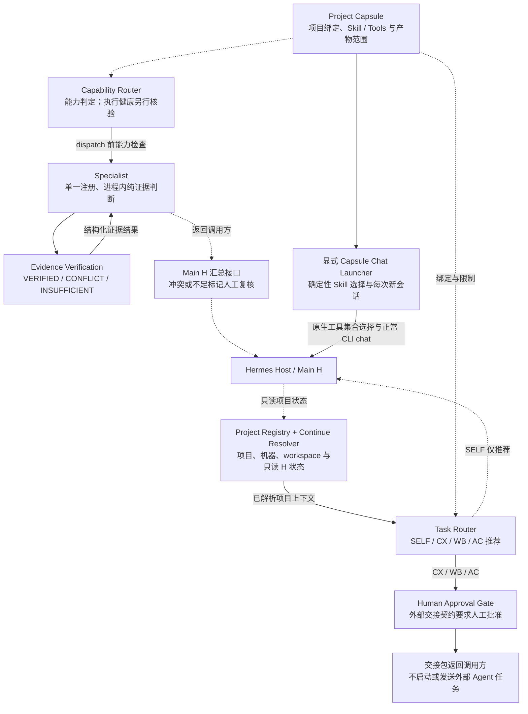

# H Professional Agent（HPA）

**让专业工程任务从明确的项目上下文出发，形成可审查的能力选择、执行建议与证据结论。**

HPA 是连接 Hermes（H）、Project Capsule、Memory OS 与 DHAF 的薄适配层。它帮助使用者确认“在哪个项目、当前机器能用什么、应由谁处理、依据是什么、下一步是否需要人工批准”，复用现有 Host，不修改上游核心。

当前定位是**项目上下文与任务决策层**，不是全自动多 Agent 系统。Task Router 不启动外部 Agent；正常 Hermes CLI 聊天由独立的显式 Capsule 入口发起。

## 核心价值

- **项目明确**：Registry 统一项目身份、别名、Git remote、H 项目和机器；Capsule 绑定项目根、Skill、工具、Memory namespace 与产物目录，减少串项目和旧会话误用。
- **能力有依据**：区分工具登记、会话暴露、项目允许范围与执行健康；能力目录中存在一个工具，不代表它已经可用或验证成功。
- **任务可交接**：按结构化任务特征推荐 SELF / CX / WB / AC，并生成包含范围、边界与验收条件的交接包。
- **结论可审查**：证据层区分充分支持、冲突与不足；外部交接保留人工裁决，避免把推荐直接当作执行授权。

## 系统架构

下图展示已实现模块及其职责关系。虚线表示上下文、契约或结果关系；各入口独立，图中路径不代表已经接通的自动工作流。



| 模块 | 实际职责 | 实现入口 |
| --- | --- | --- |
| Hermes Host | 沿用正常 CLI chat 与模型默认值；按进程注册选中的原生工具集合 | [hermes_entry.py](hpa/hermes_entry.py)、[chat.py](hpa/chat.py) |
| Project Registry / Continue | 核验 canonical 项目身份、当前机器、workspace 和真实 H binding；只读解析任务状态 | [registry.py](hpa/registry.py)、[continuation.py](hpa/continuation.py) |
| Project Capsule | 校验项目与会话绑定、Capsule 漂移、Skill/工具声明及适配层自己的路径范围；调用固定版本 Capsule 路由 | [core.py](hpa/core.py)、[schema](schemas/project-capsule.schema.json) |
| Capability Router / Task Router | 前者判定能力，后者推荐任务目标；不自动执行交接或 fallback | [capability.py](hpa/capability.py)、[路由说明](docs/TASK_ROUTING.md) |
| Specialist / Evidence Verification | 唯一注册的 `market-regulation-evidence-specialist` 接收受控上下文；证据层判断来源、独立支持与冲突，不自行联网检索 | [specialist.py](hpa/specialist.py)、[evidence.py](hpa/evidence.py) |
| Human Approval Gate | 外部交接固定要求 `requires_user_approval=true`、`execution_allowed=false`；未实现批准后自动执行器 | [交接契约](docs/TASK_ROUTING.md) |

Registry 不赋予执行权限；Capsule 的 `allowed_skills` / `allowed_tools` 是 Host 选择约束，**不是强制运行时安全沙箱**。Specialist 返回结果给调用方，`aggregate_result` 提供 Main H 汇总接口，不构成通用多 Agent 编排。

## 典型使用流程

1. **项目绑定**：解析已登记项目，核验机器、路径与 H 身份；需要执行时显式绑定 Capsule。未知、歧义或失效身份阻断，不猜替代目录。
2. **能力选择**：核对当前工具暴露与项目限制。Capsule 聊天入口最多选择一个 Skill 及其所需工具；低分或分差不足阻断。
3. **执行建议**：Task Router 推荐处理目标。SELF 面向低风险 H 内能力，CX 面向正式工程与 Git，WB 面向常规公开研究，AC 需明确偏好及当前项目/机器适用证据。研究与开发混合任务要求分阶段。
4. **证据验证**：在相应调用路径中提供来源记录或项目内文件摘录，返回 `VERIFIED`、`CONFLICT` 或 `INSUFFICIENT`。搜索摘要不能单独构成已验证结论。
5. **人工裁决**：审查建议、证据、范围与验收条件，再决定是否向外部 Agent 交接；冲突或不足需复核。Router 本身不发送任务、不执行审批后的动作。

这是使用与审查流程，当前没有把上述步骤串成自动执行流水线。显式 Capsule chat 会调用 H；Task Router 的推荐与 Specialist 的证据判断则通过各自接口使用。

## 典型应用场景

- **继续一个已登记工程项目**：先确认机器和 workspace，再读取 H 当前状态，避免凭项目名称猜目录。
- **准备正式开发交接**：将工程目标、最小读取范围和验收条件整理成 CX handoff，由人确认后交接。
- **拆分研究与开发**：对混合任务给出 WB → CX 的阶段建议，而非直接自动委派。
- **审查项目内证据**：由单一 Specialist 判断本地摘录的支持程度与冲突，交回 Main H/人工复核；不替代专业监管裁决。

## 安装与快速使用

需要 Git、Python 3.11+。下列命令适用于 Windows / Boot Camp Windows；原生 macOS 未获真实验收。安装 HPA 不会安装或配置 Hermes、Memory OS 或 DHAF。

```powershell
git clone --branch main https://github.com/hcxhcx1981-hash/h-professional-agent.git
Set-Location h-professional-agent
python -m venv .venv
.\.venv\Scripts\python.exe -m pip install .
```

安装会获取 `pyproject.toml` 中固定提交的 Capsule 依赖，并在选择前校验其 Python 文件完整性。

### 最小示例：只获取执行建议

前提：本机已有 Hermes 项目登记，以及经过核验的 canonical Registry。公开 [Registry 示例](hpa/project-registry.example.json) 是虚构身份，不能直接用作真实配置；缺少本机 Registry 时阻断，不回退到示例。

按 [Registry 配置说明](docs/PHASE_2A_PROJECT_REGISTRY.md) 创建并核验忽略的 `hpa/project-registry.local.json`，再执行：

```powershell
# 替换占位符；HERMES_HOME 是现有 H 数据目录，PROJECT_ROOT 是已登记项目目录。
.\.venv\Scripts\python.exe -X utf8 -B -m hpa.capability '继续开发 h-professional-agent，增加跨文件正式功能并做 Git 收口' --task-route --hermes-home '<HERMES_HOME>' --trusted-root '<PROJECT_ROOT>' --acceptance '相关测试与构建通过' --relevant-path hpa/capability.py --relevant-path tests/test_task_routing.py
```

该示例针对已登记的 HPA 项目，输出路由决策和可能的 handoff JSON，**不会执行开发或启动 CX**。其他项目需替换任务、范围与验收条件。wheel 安装场景可用 `--registry-file` 指向本机配置。

### 可选：显式 Capsule 聊天入口

这一入口仍是 synthetic fixture 适配链，需要已配置的 Hermes、固定版本 Memory OS 与 DHAF checkout。复制 [local.example.toml](local.example.toml) 为忽略的 `local.toml`，按模板绑定本机非秘密路径后，可运行：

```powershell
.\.venv\Scripts\python.exe -B -m hpa.chat --config local.toml --capsule fixtures/A/project-capsule.json --task 'inspect meridian report'
```

该命令会发起真实模型会话并生成项目内产物，不是离线路由示例。每次调用新建 H 会话，不复用其他项目历史；Memory 适配器只接显式 synthetic JSON fixture。完整集成与验收入口见 [既有验收说明](VALIDATION.md) 和 [verify.bat](verify.bat)，真实 H 工具暴露及独立 Memory OS Router 接口见 [Tool Reliability](docs/TOOL_RELIABILITY.md)。

## 当前能力与验证范围

“已实现”描述代码；“已验证”限定在已有验收记录的场景，不等同于当前机器或任意任务均可用。

| 状态 | 范围 |
| --- | --- |
| 已实现 | canonical Registry、只读 Continue、Capsule 绑定与确定性 Skill 选择、Capability Router、Task Router 与 handoff 契约、单一 Specialist、纯证据判断、显式正常 H CLI chat 适配 |
| 已验证（历史记录） | [V0.1 验收](VALIDATION.md) 记录 synthetic A/B 的正常 H CLI chat、选中原生工具、独立新会话及预检阻断；产物不在公开 Git 中，不能视为可直接重放的公开 Demo |
| 已验证（现有阶段文档） | [Registry 验收](docs/PHASE_2A_PROJECT_REGISTRY.md) 记录真实 H/remote/机器身份解析；[Task Routing 验收](docs/TASK_ROUTING.md) 记录真实 CX handoff E2E，仅验证推荐/交接，不证明自动执行 |
| 尚未实现 | 自动外部 Agent 启动与派发、批准后自动执行、队列/调度/工作流、通用多 Specialist 平台、LLM Router、强制运行时项目沙箱、DHAF 正式在线防护 |
| 尚未验证 | 任意真实工程任务端到端自动完成、任意恶意模型的跨项目隔离、原生 macOS、另一台物理 Boot Camp 机器；新机器须重新验收 |

阶段文档记录过全量旧 Scope 测试因 Capsule 或 Memory/DHAF 路径缺失而无法完成。测试源码可查 [tests](tests)，能力判定结果中的健康状态仍需实际调用证据；不能以工具登记或历史通过代替现场验证。

## 安全边界与已知限制

- **身份与范围检查有明确边界**：跨机器、Registry 损坏、路径不可用、歧义和 stale binding 等会阻断；HPA 校验自己处理的路径与产物。H 的原生 `read_file` / `terminal` 等工具没有被替换成项目文件沙箱。
- **提示词不是安全隔离**：Skill 正文和任务限制仍属于提示词；每进程工具集合选择不证明任意恶意模型无法访问其他目录。这里的项目隔离指身份、会话、上下文与适配层路径检查。
- **人工批准是交接要求**：Task Router 不实现在线批准服务，也不执行交接。调用方负责真实审批与后续操作；推荐的风险/复杂度分类不是执行安全证明。
- **DHAF 仅 Shadow**：建议与日志不执行动作，始终 `SHADOW_ONLY / NOT_LIVE_READY`，没有强制 live gate。
- **Memory 接入需区分**：早期 HPA chat/Memory 层只处理 synthetic fixture；独立 Memory OS 官方 Router 与 Hermes 原生记忆是不同接口，不应混为生产记忆链。Registry/Continue 只读项目元数据，不读取原始任务内容。
- **自然语言解析有限**：Capsule Skill 路由以英文词汇/显式触发短语为主；Task Router 对复杂语义可能需要调用方补充结构化特征，没有 LLM 分类或翻译兜底。
- **集成与验证有限**：这是 CLI 薄适配，不是 Electron Desktop 全局安装。实际工具暴露、依赖版本与 Host 配置需现场核验，网络或模型失败不会自动重试。
- **许可尚未确定**：HPA 未指定项目许可证，公开仓库不代表授予开源许可或自由商用权。上游组件说明见 [THIRD_PARTY.md](THIRD_PARTY.md)；Memory OS 的运行时固定提交以 [core.py](hpa/core.py) 为准，第三方说明中的旧提交不应作为当前运行依据。
